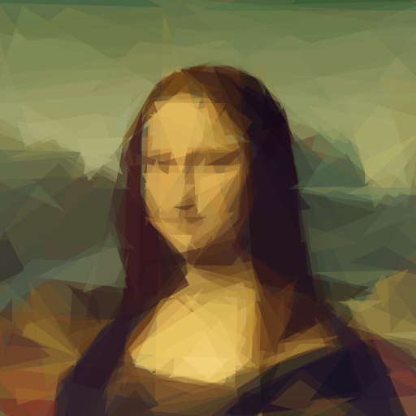
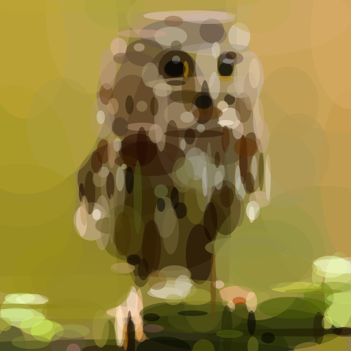
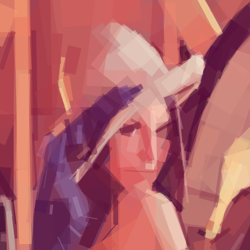
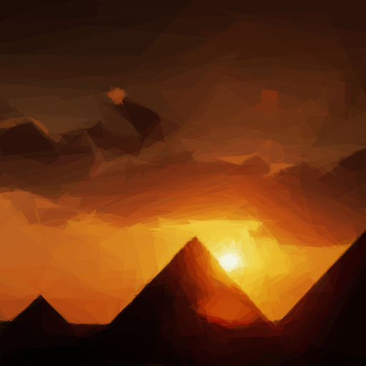
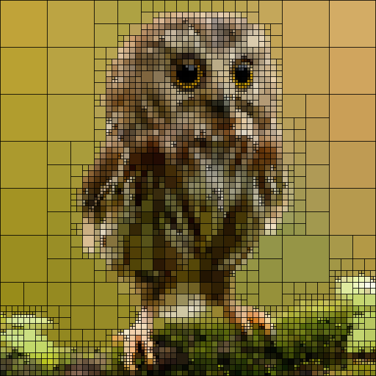
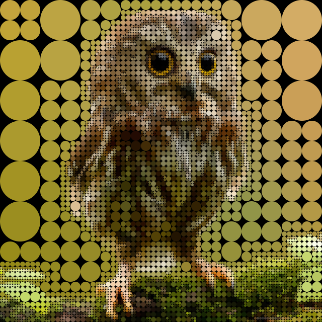

# Primitive Pictures

> **Credit.** This project is based on [primitive](https://github.com/fogleman/primitive) by [Michael Fogleman](https://github.com/fogleman), released under the MIT license (see [LICENSE.md](LICENSE.md)). The core algorithm and the original code are his. The idea was inspired by Roger Johansson's [Genetic Programming: Evolution of Mona Lisa](https://rogeralsing.com/2008/12/07/genetic-programming-evolution-of-mona-lisa/).

**Try it online:** [loyality7.github.io/primitive](https://loyality7.github.io/primitive/)

### How it Works

A target image is provided as input. The algorithm tries to find the single most optimal shape that can be drawn to minimize the error between the target image and the drawn image. It repeats this process, adding *one shape at a time*. Around 50 to 200 shapes are needed to reach a result that is recognizable yet artistic and abstract.

### Examples

Original on the left, result on the right.

| Original | Result |
| --- | --- |
|  | <br>200 triangles (`-m 1`) |
|  | <br>250 ellipses (`-m 3`) |
|  | <br>200 rotated rectangles (`-m 5`) |
|  | <br>200 polygons (`-m 8`) |
|  | <br>900 splits (`-algo quads`) |
|  | <br>1500 splits (`-algo quads -cell circle`) |

### Animated SVG

`-anim 0.08 -o out.svg` makes an SVG where each shape fades in after the previous one. Open the file in a browser to watch the picture build.



### Command-line Usage

Run it on your own images! First, [install Go](https://golang.org/doc/install).

    go install github.com/loyality7/primitive/cmd/primitive@latest
    primitive -i input.png -o output.png -n 100

Small input images should be used (like 256x256px). You don't need the detail anyway and the code will run faster.

| Flag | Default | Description |
| --- | --- | --- |
| `i` | n/a | input file |
| `o` | n/a | output file |
| `n` | n/a | number of shapes |
| `m` | 1 | mode: 0=combo, 1=triangle, 2=rect, 3=ellipse, 4=circle, 5=rotatedrect, 6=beziers, 7=rotatedellipse, 8=polygon |
| `rep` | 0 | add N extra shapes each iteration with reduced search (mostly good for beziers) |
| `nth` | 1 | save every Nth frame (only when `%d` is in output path) |
| `r` | 256 | resize large input images to this size before processing |
| `s` | 1024 | output image size |
| `a` | 128 | color alpha (use `0` to let the algorithm choose alpha for each shape) |
| `bg` | avg | starting background color (hex) |
| `j` | 0 | number of parallel workers (default uses all cores) |
| `seed` | random | RNG seed, for reproducible output (use with `-j 1`) |
| `int` | 50 | frame interval for GIF output |
| `anim` | 0 | animate SVG output: seconds between shapes appearing (0 = static) |
| `edge` | 0 | 0-1: chance a new shape is anchored near high-detail areas (Sobel edges). Off by default. Measured gain is small: about 1% lower error in detailed regions, none overall. |
| `algo` | shapes | `shapes` (default) or `quads`. With `quads` the picture is built from squares, and `-n` is the number of splits (1000 to 3000 is a good range). The shape-only flags (`-m`, `-a`, `-rep`, `-bg`, `-palette`, `-edge`, `-blur`, `-seed`, `-j`) are rejected with `quads`. |
| `border` | 1 | quads only: width in pixels of the dark outline around each square. 0 gives plain squares. |
| `cell` | square | quads only: `square` or `circle`. |
| `quality` | n/a | preset for `n` and `r`: `draft` (150 shapes, `r` 256) or `high` (400 shapes, `r` 512). An explicit `-n` or `-r` overrides the preset. `high` took about 27s on a 512px image. |
| `blur` | 0 | SVG output only: gaussian blur radius in image pixels. Try 1 to 2; 4 is very soft. PNG and JPG are unaffected. |
| `palette` | n/a | restrict shape colors to a comma-separated hex list, e.g. `#000000,#ff0000,#ffffff` |
| `v` | off | verbose output |
| `vv` | off | very verbose output |
| `int` | 50 | interval between frame in a gif in millis (works only with .gif output)|

Tip: for detail, such as the curve of a smile, raise the shape count and the working resolution: `-n 400 -r 512` cut the error in a face region by about 27% compared with `-n 150 -r 256` on the Mona Lisa example, and took about 27 seconds. Triangles (`-m 1`) and rotated ellipses (`-m 7`) were about equally accurate at those settings; triangles gave a sharp low-poly look and ran 2x faster, ellipses a softer look.

### Web version

`web/index.html` runs both engines in the browser through WebAssembly: pick a photo, choose shapes, squares or circles, watch the picture build, download SVG (also animated) or PNG. Build the engine once, then serve the `web/` folder with any static file server:

```
GOOS=js GOARCH=wasm go build -o web/primitive.wasm ./cmd/wasm
cp "$(go env GOROOT)/lib/wasm/wasm_exec.js" web/
python -m http.server 8000     # then open http://localhost:8000/web/
```

Hosting it needs only `index.html`, `wasm_exec.js` and `primitive.wasm`; Go is not needed on the server. The browser build uses one thread, so it is slower than the command line. The `tests/wasm/` scripts check it end to end in Node (`node tests/wasm/e2e.mjs`).

### Quadtree mode

`-algo quads` builds the picture from cells instead of shapes. It starts with one cell filled with the average color of the photo, then keeps splitting the cell with the largest error into four, up to `-n` times. Flat areas stay as a few big cells and the splits go to edges and gradients. It is fast and has no randomness, so the same input always gives the same output.

```
primitive -i photo.jpg -o out.png -algo quads -n 3000 -r 512
primitive -i photo.jpg -o out.png -algo quads -n 3000 -r 512 -cell circle
```

- Squares get a thin dark outline by default. `-border 0` gives plain squares, which look pixelated; `-border 3` gives heavier lines.
- `-cell circle` draws each cell as a circle on a black background.
- Output can be PNG, JPG, SVG or GIF. `-anim 0.01` makes an SVG where the picture builds up split by split.
- Photos with big flat areas (a plain sky or background) look best. A textured photo needs many more splits.

The idea comes from [Quads](https://github.com/fogleman/Quads) by Michael Fogleman. This is a separate implementation written from the algorithm description and from looking at the pictures it produces.

### Project layout

```
cmd/primitive/        command-line tool
cmd/wasm/             browser entry point (Go compiled to WebAssembly)
primitive/            the engine: model, workers, scoring
  shape/              Shape interface and every shape (triangle, ellipse, ...), edge-weighted placement
  rasterize/          scanlines and path rasterising
  colors/             colors and palettes
  quad/               quadtree engine (-algo quads)
  optimize/           hill climbing
  imageio/            load and save PNG, JPG, SVG, GIF
  internal/num/       small maths helpers
tests/                all tests, with golden outputs in tests/testdata
web/                  browser page for the WASM build
contrib/              old Python bot and scripts, not used by the tool
docs/, examples/      images used by this README and sample inputs
```

To add a new shape, implement `shape.Shape` in `primitive/shape/` and register it in `Worker.RandomState`. Run `go test ./...` before and after: the golden tests fail if any existing output changes.

Build with `go build -o bin/primitive ./cmd/primitive`, or `make build`, `make web`, `make test` if you have make.

### Output Formats

Depending on the output filename extension provided, you can produce different types of output.

- `PNG`: raster output
- `JPG`: raster output
- `SVG`: vector output
- `GIF`: animated output showing shapes being added - requires ImageMagick (specifically the `convert` command)

For PNG and SVG outputs, you can also include `%d`, `%03d`, etc. in the filename. In this case, each frame will be saved separately.

You can use the `-o` flag multiple times. This way you can save both a PNG and an SVG, for example.

### How it Works, Part II

Say we have a `Target Image`. This is what we're working towards recreating. We start with a blank canvas, but we fill it with a single solid color. Currently, this is the average color of the `Target Image`. We call this new blank canvas the `Current Image`. Now, we start evaluating shapes. To evaluate a shape, we draw it on top of the `Current Image`, producing a `New Image`. This `New Image` is compared to the `Target Image` to compute a score. We use the [root-mean-square error](https://en.wikipedia.org/wiki/Root-mean-square_deviation) for the score.

    Current Image + Shape => New Image
    RMSE(New Image, Target Image) => Score

The shapes are generated randomly. We can generate a random shape and score it. Then we can mutate the shape (by tweaking a triangle vertex, tweaking an ellipse radius or center, etc.) and score it again. If the mutation improved the score, we keep it. Otherwise we rollback to the previous state. Repeating this process is known as [hill climbing](https://en.wikipedia.org/wiki/Hill_climbing). Hill climbing is prone to getting stuck in local minima, so we actually do this many different times with several different starting shapes. We can also generate N random shapes and pick the best one before we start hill climbing. [Simulated annealing](https://en.wikipedia.org/wiki/Simulated_annealing) is another good option, but hill climbing was found to be just as good and faster, at least for this particular problem.

Once we have found a good-scoring shape, we add it to the `Current Image`, where it will remain unchanged. Then we start the process again to find the next shape to draw. This process is repeated as many times as desired.

### Primitives

The following primitives are supported:

- Triangle
- Rectangle (axis-aligned)
- Ellipse (axis-aligned)
- Circle
- Rotated Rectangle
- Combo (a mix of the above in a single image)

More shapes can be added by implementing the following interface:

```go
type Shape interface {
	Rasterize() []Scanline
	Copy() Shape
	Mutate()
	Draw(dc *gg.Context)
	SVG(attrs string) string
}
```

### Features

- [Hill Climbing](https://en.wikipedia.org/wiki/Hill_climbing) or [Simulated Annealing](https://en.wikipedia.org/wiki/Simulated_annealing) for optimization (hill climbing multiple random shapes is nearly as good as annealing and faster)
- Scanline rasterization of shapes in pure Go (preferable for implementing the features below)
- Optimal color computation based on affected pixels for each shape (color is directly computed, not optimized for)
- Partial image difference for faster scoring (only pixels that change need be considered)
- Anti-aliased output rendering

